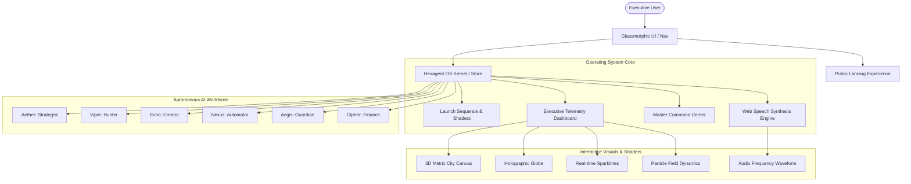

<div align="center">

# ⚡ HEXAGENT
### The Autonomous AI Workforce Operating System

*The future doesn't hire. It deploys AI employees.*  
**Run an entire enterprise powered by 6 coordinated, autonomous AI agents.**

<br />

[](https://hexagent-kappa.vercel.app)
[](https://github.com/hasim2006/Hexagent/actions)
[](LICENSE)

[](https://react.dev)
[](https://www.typescriptlang.org)
[](https://vitejs.dev)
[](https://tailwindcss.com)
[](https://lucide.dev)

<br />

[Explore Live Demo](https://hexagent-kappa.vercel.app) · [Report Bug](https://github.com/hasim2006/Hexagent/issues) · [Request Feature](https://github.com/hasim2006/Hexagent/issues)

</div>

---

## 📑 Table of Contents
- [Executive Overview](#-executive-overview)
- [Live Public Platform](#-live-public-platform)
- [The 6 AI Employees](#-the-6-autonomous-ai-employees)
- [System Architecture](#-system-architecture)
- [Core Features](#-core-features)
- [Domain-Driven Directory Structure](#-domain-driven-directory-structure)
- [Getting Started](#-getting-started)
- [Available Scripts](#-available-scripts)
- [Security & Contribution](#-security--contribution)
- [Author & Acknowledgments](#-author--acknowledgments)

---

## 🌐 Executive Overview

**Hexagent** is an enterprise-grade conceptual Operating System designed to replace traditional corporate departmental silos with a unified fleet of **6 specialized, autonomous AI agents**. 

Each AI employee manages their own interactive workspace, collaborates asynchronously across an enterprise neural network, and streams real-time telemetry into a unified Executive OS Dashboard with integrated voice synthesis briefings.

---

## 🔗 Live Public Platform

The application is deployed on Vercel's global edge network:

> **Production URL:** [https://hexagent-kappa.vercel.app](https://hexagent-kappa.vercel.app)

---

## 👥 The 6 Autonomous AI Employees

| Employee | Codename | Department | Primary Focus | Capabilities |
| :--- | :--- | :--- | :--- | :--- |
| **Strategist** | `Aether` | Executive Direction | Market Moat & Strategy | Real-time OKR synthesis, predictive competitor benchmarking, trajectory mapping |
| **Hunter** | `Viper` | Revenue & Growth | Pipeline Acquisition | Autonomous lead scoring, high-converting cold sequencing, deal telemetry |
| **Creator** | `Echo` | Design & Marketing | High-Velocity Content | Multi-channel viral copy, creative brand design, audience sentiment tracking |
| **Automator** | `Nexus` | Systems & DevOps | Zero-Touch Infrastructure | Cross-API workflow orchestration, self-healing pipeline scripts, incident routing |
| **Guardian** | `Aegis` | Security & Compliance | Defensive Shield | Continuous vulnerability scanning, compliance audit logs, perimeter defenses |
| **Finance** | `Cipher` | Treasury & Capital | Unit Economics & P&L | Real-time burn-rate simulation, automated revenue forecasting, capital allocation |

---

## 📐 System Architecture

Hexagent's runtime follows a domain-driven reactive state pipeline:



---

## ✨ Core Features

- **🎮 Cyberpunk Glassmorphic UI:** Custom dark-mode theme built with backdrop blur filters, tailored HSL glow palettes, and micro-animations.
- **🎙️ AI Voice Briefings:** Integrated browser Web Speech synthesis with simulated CEO situational audio briefings and real-time audio waveforms.
- **🕹️ 6 Interactive Workspaces:** Dedicated deep-dive environments for each AI employee featuring custom metrics, live status controls, and simulated execution logs.
- **📊 Real-time Telemetry & Terminal:** Simulated system event streams, enterprise activity logs, and an interactive command-line terminal.
- **⚡ Ultra-Fast Vite Pipeline:** Sub-second HMR and optimized production bundle output deployed directly to global CDN edge nodes.

---

## 🏛️ Domain-Driven Directory Structure

```
Hexagent/
├── .github/                  # GitHub Actions CI, issue and PR templates
├── public/                   # Static branding assets and documentation
├── src/
│   ├── components/
│   │   ├── ui/               # Reusable primitives (GlassCard, MagneticButton, Loader, Section)
│   │   ├── visuals/          # 3D, canvas shaders & graphs (CityCanvas, HoloGlobe, LiveGraph)
│   │   ├── landing/          # Public marketing showcase (Hero, CommandCenter, LiveNetwork, Metrics)
│   │   ├── workforce/        # Employee showcase & thinking visualizers (Employees, AIPod)
│   │   ├── dashboard/        # Executive OS suite (Dashboard, CEOBriefing, LiveTerminal, MasterCommand)
│   │   ├── workspaces/       # 6 AI Employee Workspaces + WorkspaceShell
│   │   └── index.ts          # Central barrel re-export registry
│   ├── os/                   # OS store, boot sequence, audio synthesis
│   ├── data/                 # AI employee configuration & telemetry constants
│   ├── hooks.ts              # Reactive animation and mouse tracking hooks
│   ├── App.tsx               # Root view router
│   ├── main.tsx              # React DOM entry
│   └── index.css             # Tailwind & custom CSS shaders
├── vercel.json               # Vercel SPA routing and deployment rules
└── vite.config.ts            # Vite bundler configuration
```

---

## 🚀 Getting Started

### Prerequisites
- Node.js (v18.0.0 or higher recommended)
- npm (v9.0.0 or higher)

### Installation
```bash
# Clone the repository
git clone https://github.com/hasim2006/Hexagent.git

# Navigate into the project directory
cd Hexagent

# Install dependencies
npm install
```

### Local Development
```bash
npm run dev
```
Open your browser and navigate to `http://localhost:5173`.

---

## 🛠️ Available Scripts

| Script | Purpose | Command |
| :--- | :--- | :--- |
| `dev` | Launches Vite local development server | `npm run dev` |
| `build` | Bundles and optimizes the production build into `/dist` | `npm run build` |
| `preview` | Runs a local static preview of the production bundle | `npm run preview` |
| `typecheck` | Validates TypeScript types across the entire project | `npm run typecheck` |
| `lint` | Runs ESLint analysis for code quality | `npm run lint` |

---

## 🤝 Security & Contribution

- Contributions, issues, and feature requests are welcome! Feel free to review our [Contributing Guide](CONTRIBUTING.md).
- To report security vulnerabilities, please refer to our [Security Policy](SECURITY.md).

---

## 👤 Author

**Mohammad Hasim**
- GitHub: [@hasim2006](https://github.com/hasim2006)
- Repository: [https://github.com/hasim2006/Hexagent](https://github.com/hasim2006/Hexagent)

---

## 📄 License

This project is licensed under the terms of the GNU General Public License v3.0 - see the [LICENSE](LICENSE) file for details.
